### Laporan Tugas Integrasi Database – NotarisAI ###

# Anggota Kelompok #
1. Ali Ma'sum Ajjawiyi
2. Noval Adrian
3. Khairul Tamam
4. Avis Budiman Tauladani
5. Kurniawan Aji Saputra

## 1. Ringkasan ##

Pada tugas ini, data aplikasi NotarisAI yang sebelumnya berupa data dummy lokal dipindahkan ke database Supabase (PostgreSQL). Aplikasi membaca dan menulis data melalui `@supabase/supabase-js`.

## 2. Koneksi ke Supabase ##

- Klien dibuat di `src/lib/supabase.ts` memakai `EXPO_PUBLIC_SUPABASE_URL` dan kunci publishable dari file `.env`.
- Sesi disimpan lewat AsyncStorage (mobile) dan localStorage (web), dengan `autoRefreshToken` aktif.

Bukti:
- EXPO_PUBLIC_SUPABASE_URL=https://krzyuwzyuzlmvsgdfzij.supabase.co
- Dashboard Supabase yang menunjukkan proyek aktif: 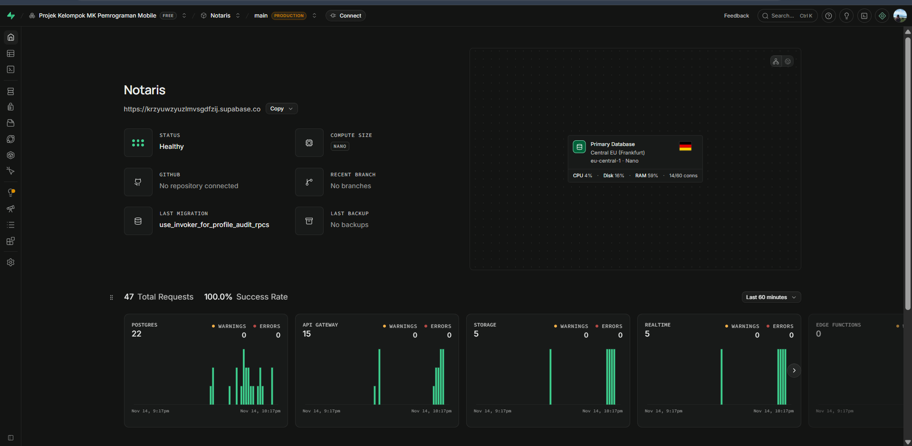

---

## 3. Struktur Database ##

Tabel yang digunakan:

| Tabel | Fungsi |
|-------|--------|
| `profiles` | Profil pengguna (nama, peran, status aktif), terhubung ke `auth.users` |
| `services` | Data layanan/berkas klien |
| `service_types` | Jenis layanan |
| `service_members` | Staf yang ditugaskan pada layanan |
| `akta` | Data akta (Repertorium) |
| `laporan_periode` | Status laporan per bulan |
| `laporan_snapshot` | Salinan data akta saat laporan disetujui |
| `konfirmasi_kategori` | Konfirmasi kategori kosong per bulan |

Fungsi dan trigger di server:
- RPC: `create_service`, `next_nomor_urut`, `setujui_laporan`, `minta_revisi`
- Trigger `handle_new_user`: membuat baris `profiles` dan `akun` otomatis saat pengguna baru dibuat di Auth
- Trigger `sync_profile_active_to_auth`: menolak login pengguna yang dinonaktifkan Notaris
- Edge Function `create-staff`: membuat akun staf, hanya bisa dipanggil Notaris aktif

---

## 4. Bukti Per Tabel dan Alur CRUD ##

Setiap bagian menampilkan contoh isi tabel di Supabase dan GIF alur di aplikasi yang menghasilkan data tersebut.

### 4.1 `profiles` dan `akun` ###

**data:**

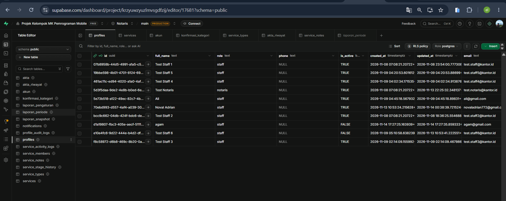

**Alur tambah staf dan nonaktif staf:**

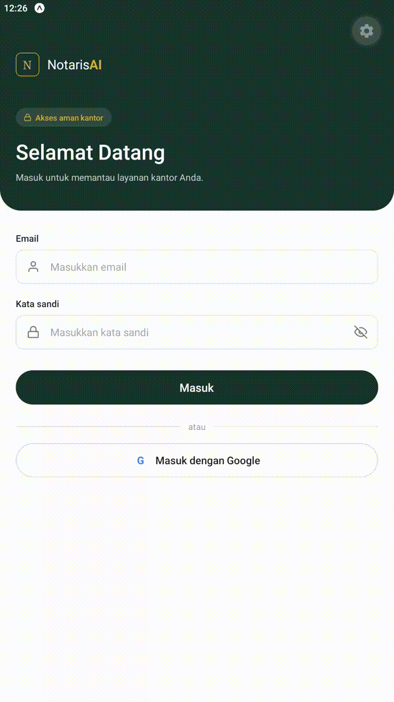

### 4.2 `service_types` ###

**Fungsi:** jenis layanan yang tersedia

**data:**

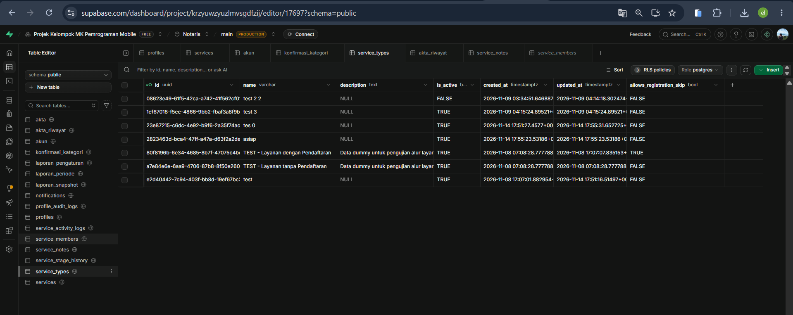

**Alur tambah, ubah, dan nonaktifkan:**

### 4.3 `services` dan `service_members`

**Fungsi:** layanan klien dan staf yang ditugaskan

**data:**
1. tabel services
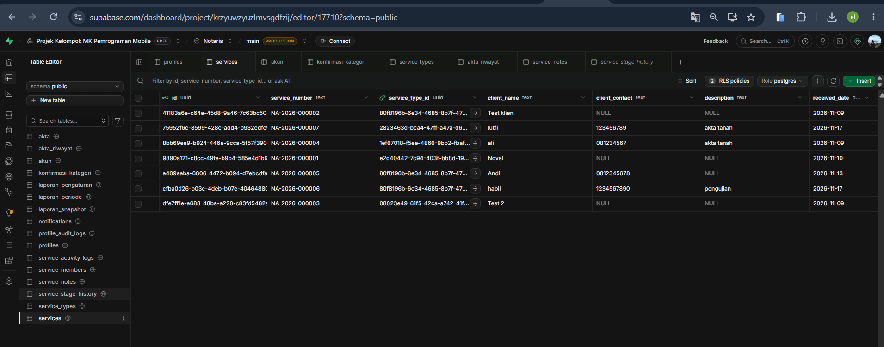

2. tabel service_member
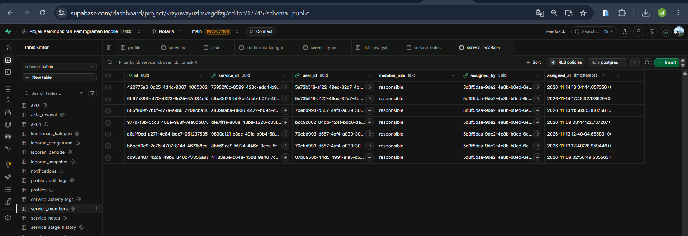

**Alur tambah layanan:**
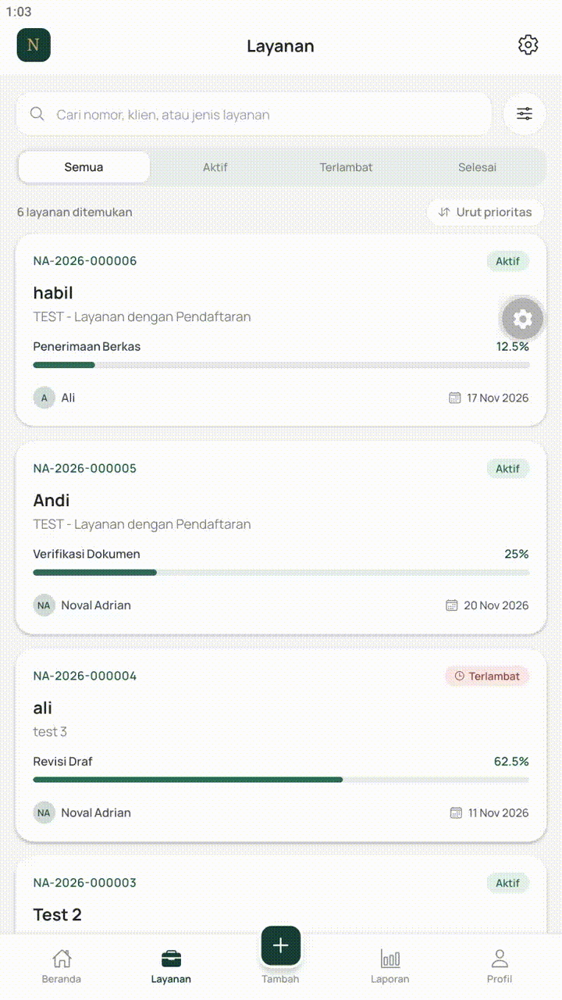

### 4.4 `akta`

**Fungsi:** data akta pada Repertorium. Nomor urut dihitung server lewat RPC `next_nomor_urut`

**data:**

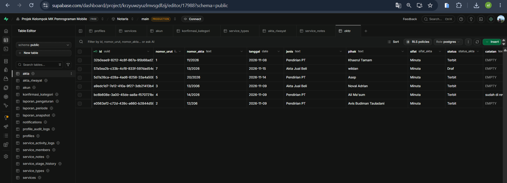

**Alur tambah akta:**

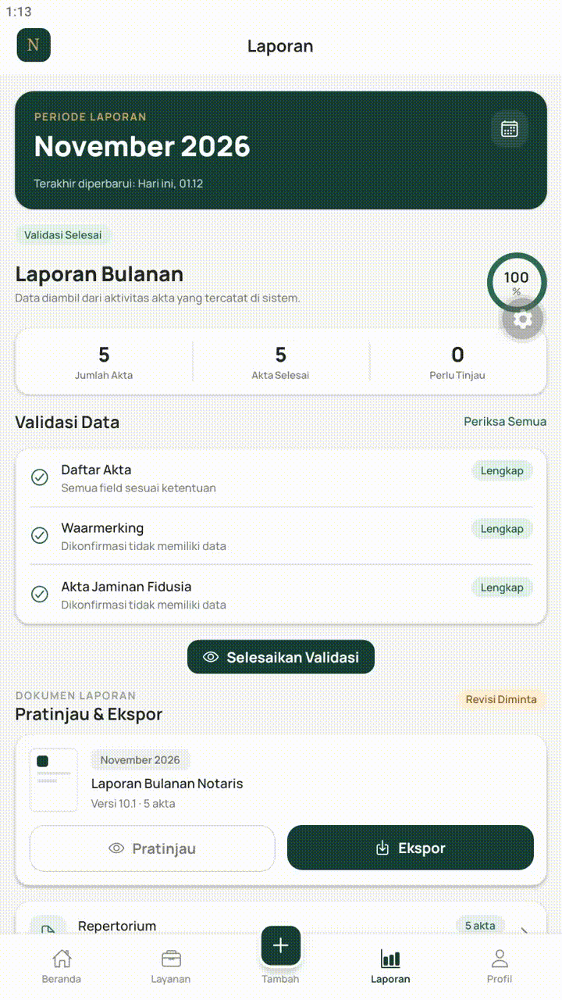

### 4.5 `konfirmasi_kategori`

**Fungsi:** mencatat konfirmasi bahwa kategori akta pada bulan tertentu memang kosong

**data:**

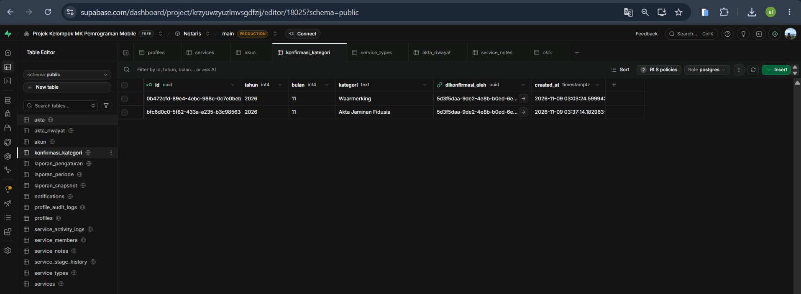

**Alur di aplikasi:**

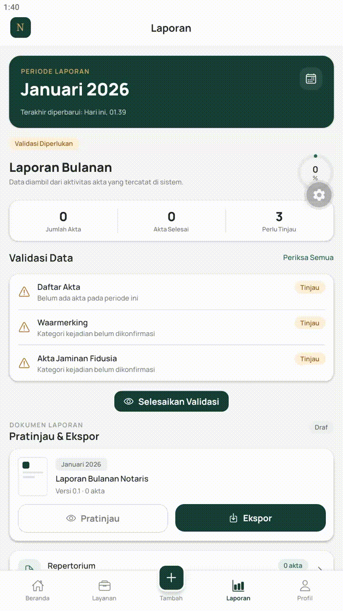

### 4.6 `laporan_periode` dan `laporan_snapshot`

**Fungsi:** status laporan bulanan dan salinan data akta saat laporan disetujui

**data:**
1. laporan_periode
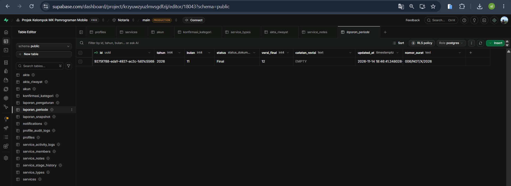
2. laporan_snapshot

**Alur setujui laporan:**

**Alur minta revisi:**

