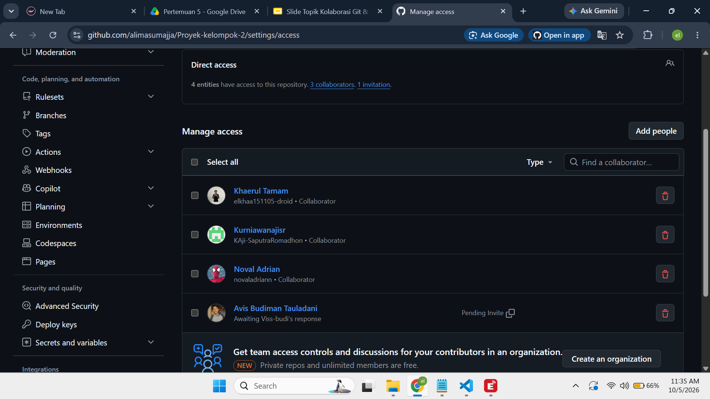
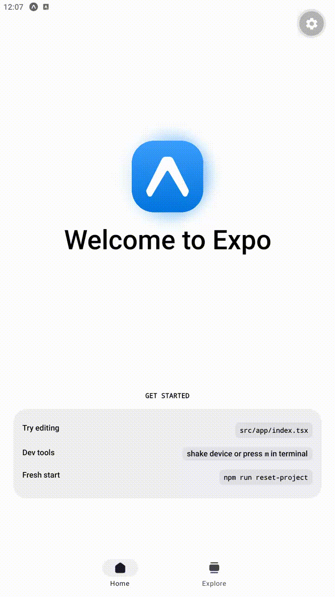
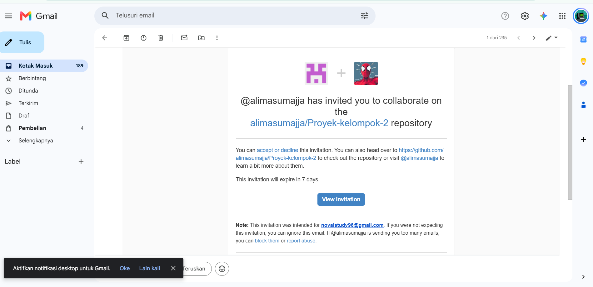
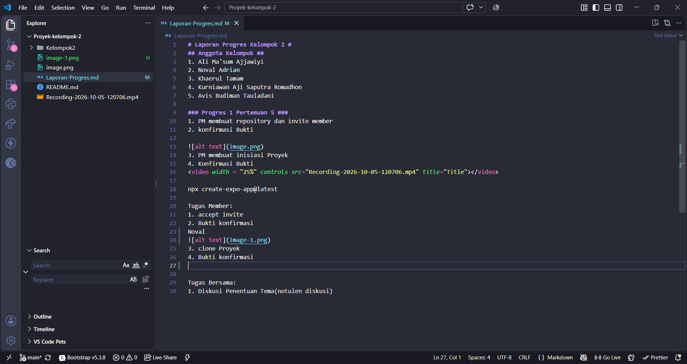
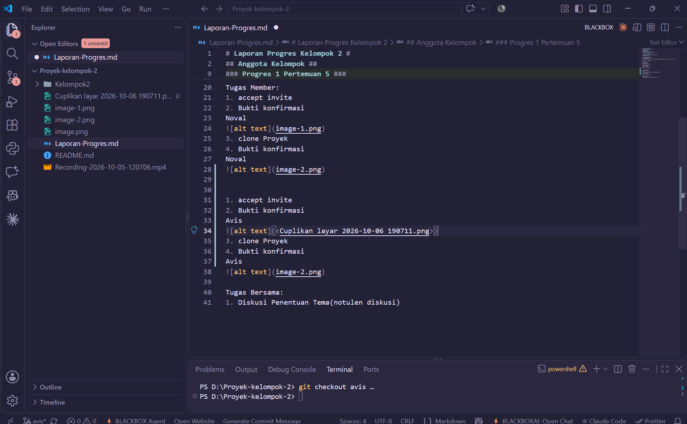
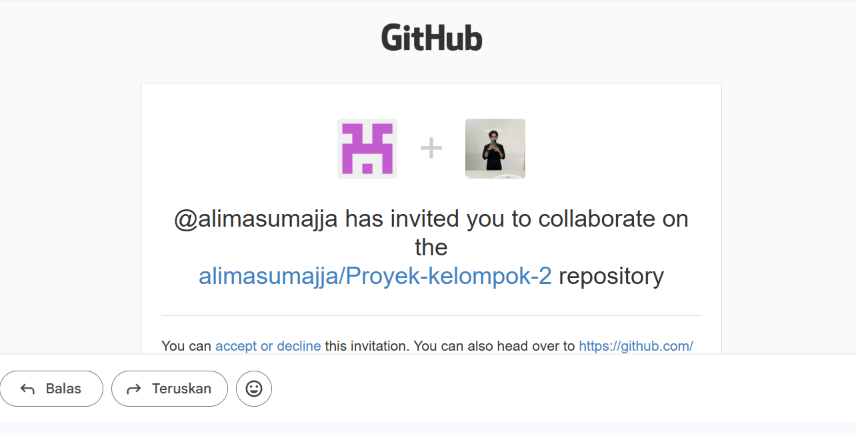
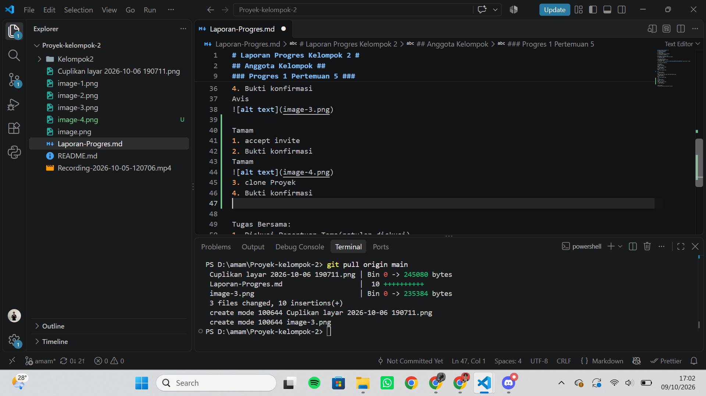
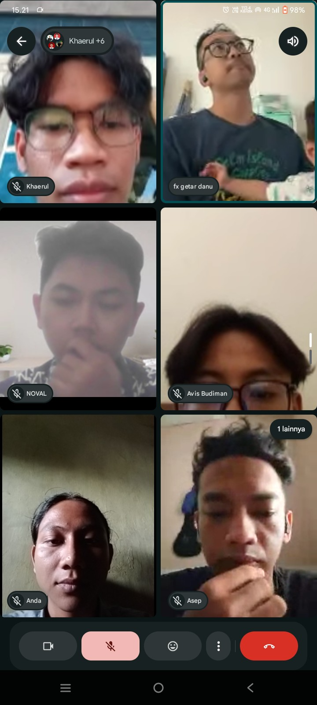
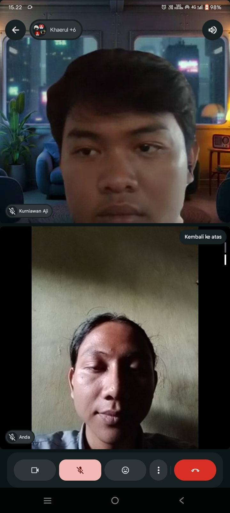
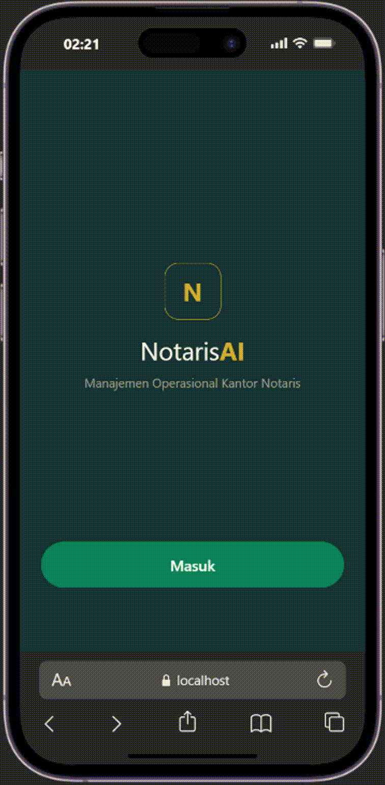

# Laporan Progres Kelompok 2 #
## Anggota Kelompok ##
1. Ali Ma'sum Ajjawiyi
2. Noval Adrian
3. Khaerul Tamam
4. Kurniawan Aji Saputra Romadhon
5. Avis Budiman Tauladani

### Progres 1 Pertemuan 5 ###
1. PM membuat repository dan invite member
2. konfirmasi Bukti

3. PM membuat inisiasi Proyek
4. Konfirmasi Bukti

npx create-expo-app@latest

Tugas Member:
1. accept invite
2. Bukti konfirmasi

Noval

3. clone Proyek
4. Bukti konfirmasi

Noval

Avis
1. accept invite
2. Bukti konfirmasi

Avis

3. clone Proyek
4. Bukti konfirmasi

Avis

Tamam
1. accept invite
2. Bukti konfirmasi

Tamam

3. clone Proyek
4. Bukti konfirmasi

Tamam

aji
1. accept invite
2. Bukti konfirmasi

aji

3. clone proyek
4. Bukti konfirmasi

aji

Tugas Bersama:
1. Diskusi Penentuan Tema(notulen diskusi)

# NOTULENSI DISKUSI PROYEK KELOMPOK 2 #
Nama Kelompok	: Kelompok 2
Hari/Tanggal	: Sabtu, 10 Oktober 2026
Waktu           : 20.00 – 21.00 WIB
Tempat/Media	: Google Meet

## Agenda Diskusi ##
1.	Mengusulkan ide tema aplikasi mobile
2.	Menentukan target pengguna aplikasi

## Daftar Ide Tema ##

### Noval ###
Mengajukan :
1)	Aplikasi Manajemen Pondok pesantren

    Target Pengguna: Santri

2)	Aplikasi Penyewaan Sepeda

    Target pengguna: Pemilik Penyewaan

### Tamam ###
Mengajukan:
1)	Pencatatan Data Notaris

    Target pengguna: Notaris
### Ali ###
Mengajukan:
1)	Aplikasi Manajemen Tugas

    Target Pengguna: Mahasiswa
### Avis ###
Mengajukan:
1)	Inventaris UMKM

    Target Pengguna: Pemilik usaha

# PROGRES PENGEMBANGAN II #

### Tema proyek ###
Aplikasi Pengembangan notaris

### Wawancara Kebutuhan Pengguna ###
Aplikasi: NotarisAI
Narasumber:
Metode: Google Meet / online
Tujuan: Mengidentifikasi kebutuhan Pengguna 
Bukti:

### Temuan ###
Berdasarkan Hasil wawancara kami menemukan temuan:
1. Progres pekerjaan dipantau melalui WhatsApp atau komunikasi langsung
2. Notaris perlu berulang kali meminta status pekerjaan kepada staf
3. Staf dan notaris sering lupa posisi terakhir suatu berkas
4. Belum ada pencatatan durasi pada setiap tahap pekerjaan
5. Berkas yang terlambat atau tidak diperbarui mudah terlewat
6. Pencatatan akta dan penutupan buku bulanan masih manual
7. Belum tersedia satu tempat untuk melihat pekerjaan aktif dan selesai

## Dari temuan tersebut mendapatkan Requirement Sistem: ##
1. FR-01 : Sistem menyediakan fitur pembaruan dan pemantauan progres pekerjaan secara terpusat
2. FR-02 : Sistem menampilkan status terbaru setiap pekerjaan yang dapat diakses oleh pengguna sesuai hak aksesnya
3. FR-03 : Sistem menyimpan status terakhir dan riwayat perubahan setiap berkas
4. FR-04 : Sistem mencatat waktu mulai, waktu selesai, dan durasi setiap tahap pekerjaan
5. FR-05 : Sistem menampilkan indikator keterlambatan dan pekerjaan yang belum diperbarui
6. FR-06 : Sistem menyediakan fitur pencatatan data akta dan penyusunan rekapitulasi untuk penutupan buku bulanan
7. FR-07 : Sistem menyediakan dashboard yang menampilkan daftar pekerjaan aktif dan selesai beserta statusnya

### Pembagian Tugas ###
Pembagian tugas pengerjaan diakukan secara diskusi bersama 

## Progres Layar Halaman ##
1. Halaman Login

2. Halaman Home/Dashboard

(image disini)

3. Halaman Layanan

(image disini)

4. Halaman Tambah layanan

(image disini)

5. Halaman Laporan

(image disini)

6. Halaman Profile

(image disini)