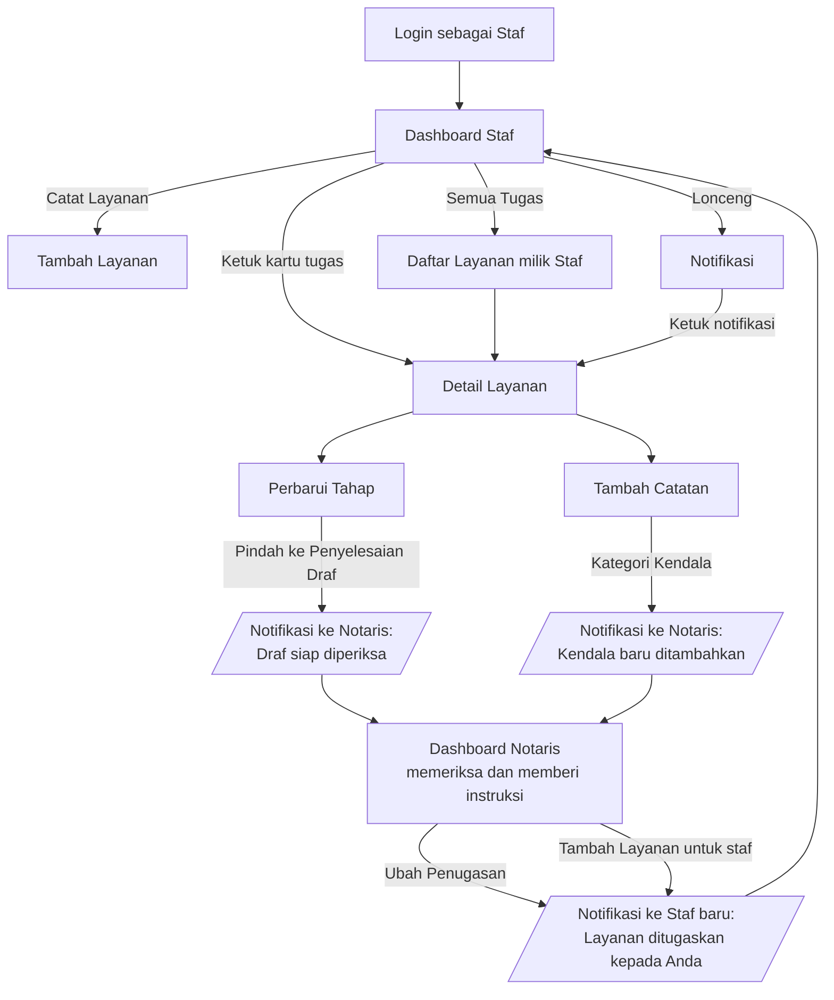

# Perbaikan Pasca-UTS — NotarisAI

> Dokumen bukti perbaikan atas masukan dosen saat presentasi UTS.
> **Cakupan:** bagian Dashboard (Beranda) dan Layanan. Tanggal: 28 Oktober 2026.
> **Platform:** Expo SDK 58 · React Native 0.88 · Expo Router.

## 1. Ringkasan

| # | Masukan dosen | Status | Bukti utama |
|---|---|---|---|
| 1 | Form CRUD **jenis layanan** (fleksibel: bisa ditambah, diubah, tidak tersedia, dihapus) | Selesai | Layar *Kelola Jenis Layanan*, 7 tes otomatis (bagian 3) |
| 2 | Input tanggal **memakai kalender**, bukan ketik manual | Selesai | Komponen `DatePickerField`, 5 tes otomatis (bagian 4) |
| 3 | **Dashboard Staf** beserta alurnya | Selesai | `StaffDashboard`, notifikasi lintas peran, 7 tes otomatis (bagian 5) |
| + | Perbaikan tambahan dari tinjauan kode, uji di perangkat, dan pertanyaan dosen saat demo (header Layanan, urut vs filter, tombol meluap) | Selesai | Bagian 6 dan 7 |

Hasil pemeriksaan otomatis: **TypeScript 0 error · bundling Android berhasil · 47 tes lolos** (bagian 8).

> **Yang belum diverifikasi:** tampilan nyata di HP untuk dialog kalender Android, kalender inline iOS, keyboard, dan `Alert`. Dashboard Staf sudah diuji di Android oleh Noval; satu masalah tampilan (tombol meluap) ditemukan dan diperbaiki (bagian 6).
> Tes berjalan dengan komponen native yang ditiru (*mock*). Gunakan checklist di bagian 10 saat uji di Expo Go.

---

## 2. Perubahan dasar yang mendukung ketiganya

- **Satu sumber data.** Beranda, Layanan, Detail, dan Notifikasi memakai `ServiceStore` yang sama, jadi perubahan di satu layar langsung terlihat di layar lain.
- **Aturan hak akses terpusat** di `utils/permissions.ts`. Layar tidak lagi membandingkan `role === 'Notaris'` sendiri-sendiri.
- **Staf hanya melihat layanan yang ditugaskan kepadanya** (keputusan tim). Berlaku di Beranda, Layanan, Detail (akses langsung ditolak), dan Notifikasi.
- **Ringkasan Beranda dihitung dari data layanan yang sama** dengan halaman Layanan. Angka kartu selalu sama dengan jumlah hasil saat kartu diketuk (lihat bagian 6).

---

## 3. Masukan 1 — CRUD Jenis Layanan

**Masalah.** Daftar jenis layanan tertulis tetap (*hard-coded*) di kode formulir Tambah Layanan. Menambah jenis atau menghapus layanan yang tidak tersedia berarti mengubah kode.

**Solusi.** Jenis layanan menjadi data yang dikelola Notaris lewat layar **Layanan → ikon label (Kelola Jenis Layanan)**, rute `/jenis-layanan`.

| Operasi | Perilaku |
|---|---|
| **Tambah** | Nama dirapikan (spasi ganda dibuang). Tolak jika kosong, lebih dari 60 karakter, atau duplikat (tidak peduli huruf besar/kecil). Jenis baru langsung tersedia di formulir Tambah Layanan. |
| **Lihat** | Tiap jenis menampilkan status *Tersedia / Tidak tersedia* dan jumlah layanan yang memakainya. |
| **Ubah nama** | Layanan yang sudah memakai nama lama **ikut diperbarui**, jadi tidak ada layanan yatim. |
| **Nonaktifkan** (sakelar) | Jenis tidak muncul di formulir layanan baru, tetapi layanan lama tetap utuh. Inilah jawaban untuk "layanan yang tidak tersedia bisa diatur". |
| **Hapus** | Hanya jika belum dipakai layanan mana pun. Jika masih dipakai, aplikasi menolak dan menawarkan **Nonaktifkan**. Ada konfirmasi sebelum menghapus. |

**Hak akses.** Hanya Notaris. Staf yang membuka rute ini melihat pesan "Hanya untuk Notaris", dan ikon pengelolaan tidak tampil di layar Layanan Staf.

**Berkas utama:** `screens/services/ServiceTypesScreen.tsx`, `components/molecules/ServiceTypeRow.tsx`, `components/organisms/ServiceTypeFormSheet.tsx`, `utils/service-types.ts` (validasi), `context/service-store.tsx` (operasi CRUD), `app/jenis-layanan.tsx`.

**Bukti uji otomatis (semua lolos):**

- ✓ validasi nama: kosong, terlalu panjang, duplikat (tak peduli huruf/spasi), boleh nama sendiri saat ubah
- ✓ Notaris: daftar awal 8 jenis, tambah jenis baru → tersedia di store
- ✓ duplikat ditolak dengan pesan, sheet tetap terbuka
- ✓ ubah nama → layanan yang memakai nama lama ikut berubah
- ✓ nonaktifkan → hilang dari pilihan formulir, layanan lama tetap utuh
- ✓ hapus: jenis yang dipakai ditolak (tawarkan Nonaktifkan); yang belum dipakai dihapus setelah konfirmasi
- ✓ Staf ditolak mengelola jenis layanan; ikon kelola hanya muncul untuk Notaris di Layanan

> **Penting — agar CRUD benar-benar mengubah formulir Tambah Layanan,** layar itu (milik Aji) harus membaca daftar dari store.
> Perubahannya kecil dan disediakan terpisah di `tambah-saran.patch` (bagian 7). Tanpa itu, formulir Tambah masih memakai daftar lama.

---

## 4. Masukan 2 — Tanggal memakai kalender

**Masalah.** Kolom tanggal berupa input teks `HH-BB-TTTT`; pengguna harus mengetik dan mudah salah format.

**Solusi.** Komponen baru `DatePickerField` memakai kalender native (`@react-native-community/datetimepicker`, paket resmi yang tersedia di Expo Go):

- **Android:** dialog kalender sistem.
- **iOS:** kalender inline di dalam *bottom sheet* dengan tombol *Pilih Tanggal*.
- Mendukung `minimumDate` / `maximumDate`. Kolom opsional bisa dikosongkan lagi dengan tombol ×; kolom wajib tidak punya tombol itu.
- Nilainya tetap string `HH-BB-TTTT`, sehingga **tidak ada layar yang perlu diubah**. `DateField` dan `DateInputField` (dipakai layar Tambah) kini hanya pembungkus tipis ke komponen yang sama.
- Kolom *Ubah Penugasan & Target* di Detail Layanan sekarang memakai kalender.

**Berkas utama:** `components/molecules/DatePickerField.tsx`, `DateField.tsx`, `DateInputField.tsx`, `utils/date.ts`; konfigurasi plugin di `app.json`.

**Bukti uji otomatis (semua lolos):**

- ✓ format tanggal bolak-balik
- ✓ iOS: ketuk → kalender inline di sheet → Pilih Tanggal mengisi nilai (format HH-BB-TTTT)
- ✓ Android: membuka dialog kalender sistem dengan batas tanggal; hasil "set" mengisi, "dismissed" diabaikan
- ✓ menampilkan tanggal terformat; kolom opsional bisa dikosongkan, kolom wajib tidak
- ✓ Detail → Ubah penugasan memakai kalender dan memperbarui target di hero

---

## 5. Masukan 3 — Dashboard Staf dan alurnya

### 5.1 Tampilan

Dashboard Staf berbeda dari dashboard Notaris. Notaris melihat ringkasan kantor; Staf melihat **pekerjaan hariannya sendiri**:

| Bagian | Dashboard Notaris | Dashboard Staf |
|---|---|---|
| Sapaan | "Berikut ringkasan operasional kantor hari ini." | "Berikut tugas Anda hari ini." (nama dari akun yang login) |
| Kartu ringkasan | Seluruh layanan kantor | Hanya layanan yang ditugaskan kepadanya |
| Aksi cepat | — | **Catat Layanan** · **Semua Tugas** |
| Daftar prioritas | Terlambat, lalu Perlu Perhatian (seluruh kantor) | **Perlu Tindakan**: miliknya yang terlambat / perlu perhatian |
| Pekerjaan berjalan | — | **Sedang Dikerjakan** (urut target terdekat, maks. 3 lalu "Lihat Semua") |
| Target terdekat | Dari seluruh layanan | Dari layanannya saja |
| Aktivitas | Aktivitas Terbaru (kantor) | **Aktivitas Saya** (dari riwayat layanannya) |

### 5.2 Alur Staf dan keterkaitannya dengan Notaris



### 5.3 Notifikasi lintas peran

| Pemicu | Penerima | Isi notifikasi |
|---|---|---|
| Staf mencatat catatan berkategori **Kendala** | Notaris | "*{Staf} menambahkan kendala pada {nomor layanan}.*" |
| Staf memindahkan layanan ke **Penyelesaian Draf** | Notaris | "*{Staf} menyelesaikan draf {nomor layanan}.*" |
| Notaris **mengubah penanggung jawab** di Detail | Staf yang baru | "*Layanan ditugaskan kepada Anda*" |
| Layanan baru dibuat dan ditugaskan ke staf lain | Staf yang ditugaskan | "*Layanan baru ditugaskan kepada Anda*" |

Notifikasi hanya tampil bagi akun yang berhak. Staf lain tidak menerimanya, dan Staf tidak menerima notifikasi layanan yang bukan miliknya.

### 5.4 Aturan akses (di `utils/permissions.ts`)

| Aksi | Notaris | Staf |
|---|---|---|
| Melihat layanan | Semua | Hanya yang ditugaskan kepadanya |
| Membuka Detail layanan orang lain | Ya | **Ditolak** ("Anda tidak memiliki akses") |
| Ubah penanggung jawab dan target | Ya | Tidak (tombol *Ubah* diganti lencana kunci) |
| Perbarui tahap, tambah catatan, Asisten AI | Ya | Ya, pada layanannya sendiri |
| Kelola jenis layanan | Ya | Tidak |
| Setujui laporan bulanan | Ya (`canApproveReport`) | Tidak |

> Penegakan di sisi tampilan saja. PRD §6.1 mewajibkan hak akses ditegakkan juga di backend/database.

**Berkas utama:** `screens/home/StaffDashboard.tsx`, `screens/home/HomeScreen.tsx` (memilih tata letak menurut peran), `utils/permissions.ts`, `utils/activity.ts`, `hooks/use-session.ts`, `screens/services/ServiceDetailScreen.tsx` (pemicu notifikasi), `context/service-store.tsx` (`addNotification`).

**Bukti uji otomatis (semua lolos):**

- ✓ Andi: tata letak khusus Staf, data hanya miliknya, aksi cepat berfungsi
- ✓ Rina: perlu perhatian muncul di prioritas, layanan selesai tidak muncul sebagai tugas
- ✓ Notaris tetap melihat dashboard kantor
- ✓ Staf mencatat Kendala → Notaris menerima notifikasi (Staf lain tidak)
- ✓ Staf menyelesaikan draf → Notaris diminta memeriksa
- ✓ Notaris menugaskan ulang → hanya staf baru yang diberi tahu; dashboard staf lama berubah
- ✓ layanan baru ditugaskan ke staf lain → staf tersebut diberi notifikasi; target kosong tampil "Belum ditentukan"

---

## 6. Perbaikan tambahan dari hasil tinjauan

| Temuan | Perbaikan | Bukti |
|---|---|---|
| **Angka ringkasan Beranda tidak cocok dengan daftar Layanan** (data dummy statis 24/12/3/5 vs 4 layanan di daftar; definisi "aktif" berbeda antara kartu dan tab) | Ringkasan dihitung dari data yang sama; definisi disamakan dengan tab: *Aktif = Aktif + Perlu Perhatian*. Label "Bulan ini" diganti "Total" (data belum punya tanggal selesai). | Tes: untuk Notaris, Andi, dan Rina, angka tiap kartu sama dengan jumlah hasil setelah kartu diketuk |
| **Error TypeScript di `main`** (4 error): tipe `receivedDate` dibuat wajib, tetapi data dummy tidak diperbarui | Data dummy dilengkapi `receivedDate` | `tsc --noEmit` → 0 error (pada `main` murni sebelumnya 4 error) |
| **Target kosong tampil "-"** dan memunculkan lencana "Sesuai target" yang menyesatkan | Penanda `NO_DUE_DATE` + `formatDueDate`: tampil "Belum ditentukan" / "Belum diatur" | ✓ detail layanan tanpa target menampilkan "Belum ditentukan", bukan "-" atau "Sesuai target" |
| **Staf tercatat sebagai satu nama tetap** di riwayat dan catatan, bukan nama akun yang login | Nama pelaku diambil dari akun aktif | Tes catatan oleh Rina tercatat "Rina Amelia" |
| **Tombol aksi cepat Staf meluap di HP** (ikon dan teks "Catat Layanan Baru" terpotong pada ukuran huruf besar) — ditemukan saat uji di perangkat Android | `Button` kini membatasi teks satu baris yang dapat menyusut (`numberOfLines`, `adjustsFontSizeToFit`, `maxFontSizeMultiplier`) dan diberi padding samping; label dipersingkat menjadi "Catat Layanan" | Tes regresi di atas. **Tampilan akhir perlu dicek ulang di HP.** |
| **Judul "Layanan" tidak di tengah** (ditemukan saat uji di Android): sisi kanan berisi dua ikon, sisi kiri satu logo, dan judul ikut tergeser oleh `space-between` | `AppHeader` memakai lapisan judul absolut di tengah baris, jadi posisi judul tidak bergantung pada lebar elemen kiri/kanan. Berlaku untuk **semua layar yang memakai header ini** (Layanan, Detail, Notifikasi, Jenis Layanan, Tambah, Profil, Laporan, Repertorium, Manajemen Staf). Tombol "+" di header Layanan dihapus karena menu *Tambah* sudah ada di bottom navigation. | Tes: judul berada di lapisan tengah; tombol "+" tidak ada |
| **Tombol "Prioritas" ambigu** (dosen bertanya apa bedanya dengan filter dan mana yang aktif): tombol itu sebenarnya *urut*, tetapi berikon filter, berganti menjadi "Reset" saat filter lain aktif, dan statusnya hanya dibedakan warna teks | **Urut dan filter dipisah** (bagian 6.1) | 8 tes otomatis (bagian 6.1) |
| **Kode kembar**: `PickerField` ≈ `SelectField`, `DateInputField` ≈ `DateField` | `SelectField` diperluas (placeholder, wajib, galat); semua nama lama menjadi pembungkus tipis | Tes layar Tambah (kode Aji, tidak diubah) tetap lolos |

### 6.1 Layar Layanan — Urut vs Filter

**Sebelum.** Satu tombol "Prioritas" berikon filter sebenarnya mengurutkan daftar; saat ada filter lain aktif, tombol yang sama berubah menjadi "Reset". Pengguna tidak bisa tahu apakah daftar sedang diurutkan, dan di sheet filter ada lagi "Prioritas" (tingkat) sehingga dua hal berbeda memakai nama yang sama.

**Sesudah.** Dua kontrol dengan peran berbeda dan status yang selalu terlihat:

| | **Filter** (menyaring) | **Urutkan** (menyusun) |
|---|---|---|
| Letak | Tombol di samping kolom pencarian | Tombol di kanan baris "n layanan ditemukan" |
| Pilihan | Tahap, penanggung jawab, **tingkat prioritas** | Bawaan · Prioritas tertinggi · Target terdekat |
| Mengubah jumlah layanan? | **Ya** (menyembunyikan yang tidak cocok) | **Tidak** (jumlah tetap, hanya susunan) |
| Status aktif terlihat | Tombol menyala hijau + **lencana angka** jumlah filter; chip tiap filter aktif; tautan **Hapus filter** | Tombol selalu bertuliskan pilihan aktif: "**Urutkan: Prioritas tertinggi**", menyala hijau penuh saat bukan Bawaan |
| Menghapus | Chip ×, atau **Hapus filter** (membersihkan tab, kata kunci, dan filter lanjutan) | Pilih *Bawaan* |

- **Tingkat prioritas tampil di setiap kartu** (bendera + teks "Tinggi/Sedang/Rendah", tidak hanya warna), sehingga hasil urut atau filter bisa diperiksa dengan mata.
- **Hapus filter tidak mengubah urutan**, dan sebaliknya mengubah urutan tidak menghapus filter.
- Sheet urut menjelaskan: "*Urutan hanya mengatur susunan daftar. Untuk menyembunyikan layanan, gunakan Filter.*"
- Urutan stabil: layanan dengan nilai sama tetap mengikuti urutan awalnya. "Target terdekat" menaruh layanan tanpa target di paling bawah.

**Berkas:** `components/organisms/ServiceSortSheet.tsx`, `components/molecules/RadioOptionRow.tsx`, `components/atoms/PriorityTag.tsx`, `components/molecules/SearchBar.tsx` (lencana jumlah filter), `components/molecules/ServiceCard.tsx`, `screens/services/LayananScreen.tsx`, `hooks/use-service-filters.ts`, `utils/service.ts` (`sortServices`), `constants/service.ts`, `types/service.ts` (`ServiceSort`).

**Bukti uji otomatis (semua lolos):**

- ✓ judul berada di lapisan tengah (absolut, kiri-kanan 0) — tidak bergantung lebar elemen samping
- ✓ tombol "+" dihapus; ikon kelola jenis hanya untuk Notaris
- ✓ kartu menampilkan tingkat prioritas (bendera + teks)
- ✓ tombol urut selalu menampilkan pilihan aktif: Bawaan → Prioritas → Target (urutan kartu diperiksa: `0021·0022·0023·0024` → `0022·0023·0021·0024` → `0024·0023·0022·0021`)
- ✓ sheet urut: pilihan aktif ditandai dan ada penjelasan urut ≠ filter
- ✓ urut tidak menyembunyikan layanan (jumlah tetap 4)
- ✓ tombol filter menampilkan jumlah filter aktif; chip dan "Hapus filter" terlihat; urutan tidak ikut terhapus
- ✓ "Hapus filter" juga membersihkan tab dan kata kunci

---

## 7. Tinjauan kode Tambah Layanan (commit `607a75b`, Aji)

**Yang sudah baik:** validasi bidang wajib dengan pesan galat, toast umpan balik, `KeyboardAvoidingView`, label aksesibilitas, nomor layanan otomatis, tahap awal otomatis, memakai komponen yang sudah ada.

| # | Temuan | Dampak | Penanganan |
|---|---|---|---|
| 1 | Tipe `receivedDate` wajib, data dummy tidak diperbarui | `tsc` gagal di `main` | **Diperbaiki** (data dummy) |
| 2 | Daftar jenis layanan tertulis tetap di layar | Tidak fleksibel | CRUD jenis layanan + `tambah-saran.patch` |
| 3 | Tanggal diketik manual | Mudah salah format | **Diperbaiki** lewat `DateInputField` → kalender, layar tidak perlu diubah |
| 4 | `PickerField` dan `DateInputField` menyalin `SelectField` dan `DateField` | Kode ganda, perawatan ganda | **Diperbaiki** (pembungkus tipis) |
| 5 | Target kosong disimpan sebagai `'-'` | Tampil janggal di Detail | **Diperbaiki** (bagian 6) |
| 6 | Staf bebas menugaskan layanan ke staf lain | Layanan itu langsung hilang dari daftar Staf pembuatnya (karena aturan akses) | `tambah-saran.patch`: penanggung jawab Staf dikunci ke dirinya |
| 7 | `addService` mencatat pembuat dengan nama bawaan peran | Riwayat salah nama | Store menerima `createdBy`; `tambah-saran.patch` mengirim nama akun |
| 8 | Dua ketukan cepat pada *Simpan* dapat membuat dua layanan dengan nomor sama | Data ganda | `tambah-saran.patch`: pengaman simpan ganda |
| 9 | Kolom "Kontak klien" memakai `keyboardType="email-address"` | Sulit mengetik nomor telepon | `tambah-saran.patch`: keyboard biasa |
| 10 | Target boleh dipilih sebelum tanggal diterima (hanya divalidasi saat simpan) | Galat baru terlihat di akhir | `tambah-saran.patch`: kalender membatasi tanggal minimum |
| 11 | Staf yang baru ditugaskan tidak diberi tahu | Alur kerja putus | **Diperbaiki** di `addService` (notifikasi) |

**Belum ditangani (catatan untuk tim):** tahun pada nomor layanan diambil dari *tanggal diterima* sedangkan urutannya global (bisa bercampur antar-tahun); data baru (`receivedDate`, `clientContact`, `description`) belum ditampilkan di Detail Layanan.

`tambah-saran.patch` mengubah **satu berkas milik Aji** (`TambahLayananScreen.tsx`) dan sengaja dipisah. Terapkan setelah dikoordinasikan dengannya.

---

## 8. Bukti verifikasi

| Pemeriksaan | Perintah | Hasil |
|---|---|---|
| Tipe TypeScript | `npx tsc --noEmit` | **0 error** |
| Lint | `npx expo lint` | 1 error lama di `hooks/use-color-scheme.web.ts` (berkas template, bukan dari perubahan ini) |
| Bundling Android | `npx expo export --platform android` | **Berhasil** (1634 modul) |
| Kesesuaian dependensi SDK | `npx expo install --check` | Dependensi sesuai |
| Tes otomatis | Jest + React Native Testing Library | **47 lolos, 0 gagal** (40 perbaikan inti + 7 usulan Tambah) |

**Uji regresi (akses data dan konsistensi angka)** — termasuk dalam 40 tes inti:

- ✓ ringkasan Beranda konsisten dengan daftar Layanan untuk **Notaris, Andi, dan Rina** (angka kartu sesuai data, dan untuk setiap kartu angkanya sama dengan jumlah hasil di tab yang dibuka) — 6 tes
- ✓ Layanan: Staf hanya melihat miliknya (+ banner), pencarian tidak membocorkan layanan orang lain
- ✓ Detail: Staf pada layanan sendiri tanpa "Ubah"; catatan dan riwayat tercatat atas nama akun (Rina)
- ✓ Detail: Staf membuka layanan orang lain → ditolak
- ✓ Notifikasi: Staf hanya melihat milik layanannya; Notaris melihat semuanya
- ✓ layar Tambah milik Aji (tidak diubah) tetap berfungsi dengan kalender dan dropdown baru
- ✓ tombol (termasuk aksi cepat Staf) tidak meluap: teks satu baris, dapat menyusut, pembesaran huruf sistem dibatasi

Catatan: pengujian menampilkan satu peringatan `act(...)` dari `FlatList` di lingkungan tes; itu tidak berasal dari aplikasi dan tidak memengaruhi hasil.

**Menjalankan ulang tes.** Berkas tes disertakan terpisah (`bukti-uji-fase2.test.tsx`, `bukti-uji-tambah-saran.test.tsx`) dan sengaja tidak dimasukkan ke repo agar tidak menambah dependensi. Cara menjalankan secara sementara:

```bash
cd Kelompok2
npm i --no-save jest@29 jest-expo@~58.0.0 @testing-library/react-native@13 \
  react-test-renderer@19.3.0 @react-native/jest-preset@0.88.0 @types/jest
# buat jest.config.js:  preset 'jest-expo', roots ['<rootDir>/__smoke__'],
#                       moduleNameMapper { '^@/(.*)$': '<rootDir>/src/$1' }
# salin berkas tes ke folder __smoke__/
npx jest
```

---

## 9. Daftar berkas

**Baru:** `components/atoms/PriorityTag.tsx` · `components/molecules/RadioOptionRow.tsx` · `components/organisms/ServiceSortSheet.tsx` · `app/jenis-layanan.tsx` · `components/molecules/DatePickerField.tsx` · `ServiceTypeRow.tsx` · `components/organisms/ServiceTypeFormSheet.tsx` · `hooks/use-session.ts` · `screens/home/StaffDashboard.tsx` · `screens/services/ServiceTypesScreen.tsx` · `utils/activity.ts` · `utils/permissions.ts` · `utils/service-types.ts`

**Diubah:** `app.json` · `package.json` · `package-lock.json` (+`@react-native-community/datetimepicker`) · `app/_layout.tsx` · `app/(tabs)/index.tsx` · `app/(tabs)/layanan.tsx` · `components/molecules/` (`DateField`, `DateInputField`, `PickerField`, `SelectField`, `SearchBar`, `ServiceCard`, `index`) · `components/organisms/` (`AppHeader` [judul di tengah], `ServiceFilterSheet`, `AssignmentCard`, `AssignmentSheet`, `ServiceHero`, `SummaryGrid`, `index`) · `context/service-store.tsx` · `data/dummy.ts` · `screens/home/HomeScreen.tsx` · `screens/notifications/NotificationsScreen.tsx` · `hooks/use-service-filters.ts` · `constants/service.ts` · `screens/services/LayananScreen.tsx` · `ServiceDetailScreen.tsx` · `types/service.ts` · `utils/date.ts` · `utils/service.ts`

**Usulan terpisah (opsional):** `screens/services/TambahLayananScreen.tsx` (`tambah-saran.patch`)

---

## 10. Checklist uji manual di Expo Go (untuk demo)

Masuk sebagai **Notaris**, lalu:

1. **Layanan → ikon label (kanan atas)** → buka *Kelola Jenis Layanan*.
2. Tambah jenis "Akta Fidusia" → muncul dengan status *Tersedia*. Tambah lagi dengan nama sama → muncul pesan duplikat.
3. Ubah nama "Akta Jual Beli" → buka Layanan, jenis layanan Siti Rahmawati ikut berubah.
4. Matikan sakelar "Waarmerking" → buka **Tambah**, jenis itu tidak ada di pilihan.
5. Hapus jenis yang dipakai layanan → ditolak dan ditawari *Nonaktifkan*; hapus jenis yang belum dipakai → berhasil setelah konfirmasi.
6. Buka Detail layanan → **Ubah** → ketuk kolom tanggal → **kalender** muncul (bukan keyboard).
7. Beranda: ketuk tiap kartu ringkasan → jumlah di daftar sama dengan angka di kartu.

Lalu **Profil → Mode Demo → Andi (Staf)**:

8. Beranda berganti menjadi **Dashboard Staf** ("Berikut tugas Anda hari ini"), hanya berisi layanan Andi.
9. Layanan hanya menampilkan 2 layanan Andi; tidak ada ikon kelola jenis layanan.
10. Buka layanan → **Tambah Catatan** → kategori *Kendala* → simpan.
11. Pindah ke **Notaris** (Mode Demo) → lonceng bertambah, notifikasi "Kendala baru ditambahkan".
12. Sebagai Notaris, **Ubah** penanggung jawab ke Rina → pindah ke Rina → notifikasi "Layanan ditugaskan kepada Anda", dan layanan itu muncul di dashboard Rina.

Layar **Layanan** (Notaris maupun Staf):

13. Judul "Layanan" berada tepat di tengah header; tidak ada tombol "+" di header.
14. Ketuk **Urutkan: Bawaan** → pilih *Prioritas tertinggi*: tombol berubah menjadi hijau bertuliskan "Urutkan: Prioritas tertinggi" dan kartu berprioritas Tinggi (bendera merah) muncul paling atas; jumlah layanan tetap.
15. Ketuk tombol filter → pilih tingkat prioritas dan staf → **Terapkan**: tombol filter menyala dengan lencana angka, chip filter tampil, jumlah layanan berkurang. Ketuk **Hapus filter**: daftar kembali penuh tetapi urutan tetap sama.

---

## 11. Keterbatasan

- Data masih berupa dummy di memori (hilang saat aplikasi ditutup). Penyimpanan permanen dan penegakan hak akses menunggu backend (Supabase).
- Asisten AI masih simulasi lokal, bukan panggilan ke model bahasa.
- Notifikasi bersifat dalam aplikasi (tanpa *push notification*).
- Belum ada aturan siapa yang boleh mengonfirmasi penyelesaian layanan dan tahap yang boleh dilewati Staf (PRD §16 masih terbuka); saat ini Staf dapat memperbarui tahap pada layanannya sendiri tanpa batas tahap.
- Persetujuan laporan bulanan (hanya Notaris) belum bisa diterapkan karena layar Pratinjau Laporan belum dibuat. Fungsi izinnya sudah siap (`canApproveReport`).