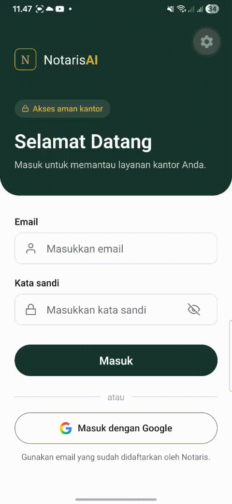
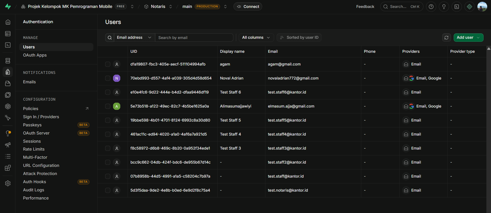
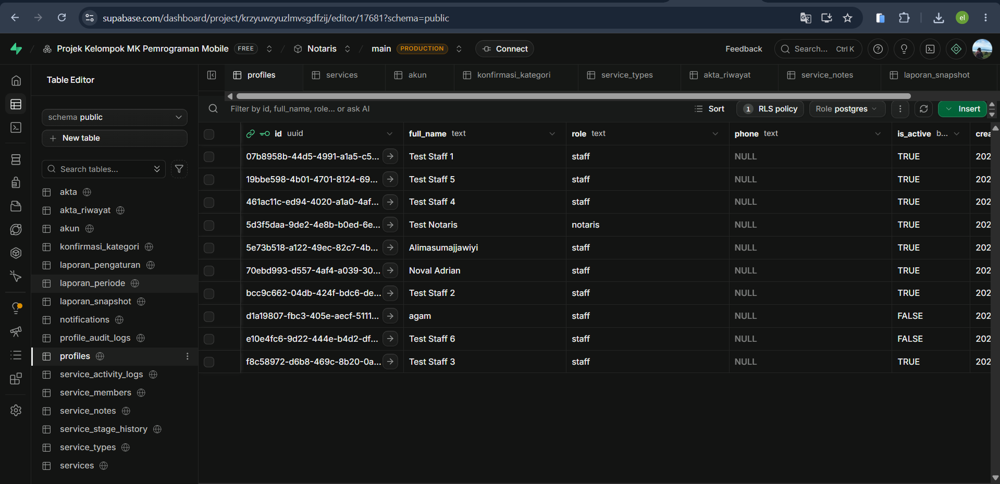

## Laporan Tugas OAuth – NotarisAI ##

# Anggota Kelompok #
1. Ali Ma'sum Ajjawiyi
2. Noval Adrian
3. Khairul Tamam
4. Avis Budiman Tauladani
5. Kurniawan Aji Saputra

## 1. Ringkasan ##

Tugas ini menyiapkan proses autentikasi aplikasi NotarisAI menggunakan Supabase Auth, mencakup login email dan kata sandi dan login OAuth (Google) menggunakan akun yang sudah terdaftar dan yang belum terdaftar.

## 2. Implementasi di Aplikasi ##

### 2.1 Login email dan kata sandi ###

[gif]

### 2.2 Login Google (OAuth) ###
Alur: tombol "Masuk dengan Google" membuka browser, pengguna memilih akun, Google mengembalikan pengguna ke aplikasi, lalu Supabase membuat sesi.

### 2.2.1 Dengan Akun yang sudah terdaftar ###

### 2.2.1 Dengan Akun yang sudah terdaftar ###

Pengguna baru dari Google muncul di Authentication > Users dan tabel `profiles`:

